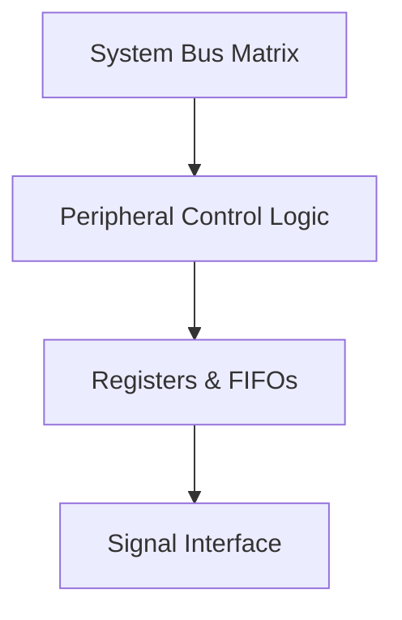

# Figure 161: Reference Manual Diagram
<!-- Self-Validated Visual Figure -->

## 1. Technical Context & Scope
Extracted diagram reference from STMicroelectronics STM32G4 RM0440 Reference Manual.
* **Figure Identifier**: Figure 161
* **Parent Chapter Context**: [Chapter 22: Digital-to-analog converter (DAC)](../chapters/chapter_22.md)
* **Hardware Architecture**: ARM 32-bit Cortex-M4

## 2. Text / ASCII & Mermaid Structural Model

## 3. Associated Hyperlinks
* **Parent Chapter**: [Chapter 22: Digital-to-analog converter (DAC)](../chapters/chapter_22.md)
* **Master System Memory Map**: [Master System Memory Map](../memory/memory_map.md)
* **Master Wiki Index**: [Wiki Root Index](../index.md)