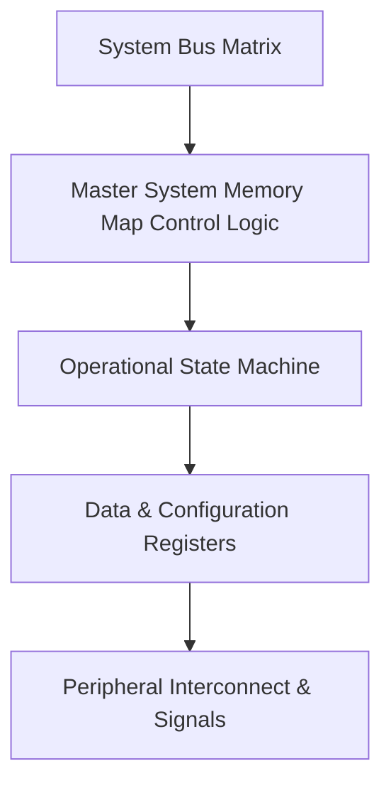

# Figure: Master System Memory Map Architectural Block Diagram

## 1. Parent Module & Reference Context
* **Parent IP Module**: [Master System Memory Map](../memory/memory_map.md)
* **PDF Document Location**: Page 79 (RM0438 Reference Manual)
* **Category**: MEMORY

## 2. Text / Pen-Sketch / ASCII & Mermaid Structural Model


```
+-------------------------------------------------------------------+
| RM0438 Block Diagram: Master System Memory Map                                |
| [Parent IP: Master System Memory Map | Page 79]                              |
+------------------------+------------------------------------------+
| Control & Status Logic | Hardware Register Interface (AHB/APB)    |
+------------------------+------------------------------------------+
| Operating State Machine| Internal FIFOs & Signal Routing          |
+------------------------+------------------------------------------+
```

## 3. Associated IP Module & Memory Links
* **Parent Peripheral IP**: [Master System Memory Map](../memory/memory_map.md)
* **Master System Memory Map**: [Master System Memory Map](../memory/memory_map.md)
* **Master Wiki Index**: [Wiki Root Index](../index.md)